# OneCode

Coding add-in for OneNote: write code with syntax highlighting, run it, and insert it into a page as a formatted block.

## Supported languages
Java (default), JavaScript, Python, C#, C++, C, Rust, R, SQL, HTML, CSS, JSON and plain text. Everything except HTML, CSS, JSON and plain text can be run.

 

## Try it on the web! (no install)
Open **https://joanna-2187.github.io/OneCode/** to use the editor in your browser. Click **Copy for OneNote**, then paste into any OneNote page (desktop or web). Colors and formatting are kept. Click **Copy** for text-only copying. 

 

## Install the full add-in (OneNote on the web only)
The add-in adds a **Code Notes** pane inside OneNote so you can insert code blocks straight onto the page.

1. Download [`manifest.xml`](manifest.xml): open it on GitHub, click the **Download raw file** button, and save it somewhere you can find it.
2. Open OneNote on the web at [onenote.com](https://www.onenote.com) and open a notebook.
3. Go to **Insert → Add-ins** (or **Office Add-ins**) → **Upload My Add-in**.
4. Choose the `manifest.xml` you downloaded and click **Upload**.
5. Open the add-in from the ribbon (**OneCode Editor**). Write code, optionally click **Run**, then click **Insert into page**.

> **Note:** Office add-ins only run on the web. The desktop OneNote app does NOT support them, but anything you edit/insert from the web shows up in the app once  the notebook syncs. The web editor above works alongside desktop OneNote or any other text editor.

 

## Step by step with pics

**Step 3.** Go to **Insert → Office Add-ins**, then open **Manage My Add-ins** and choose **Upload My Add-in**.

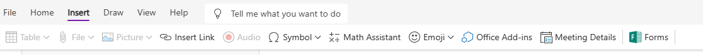

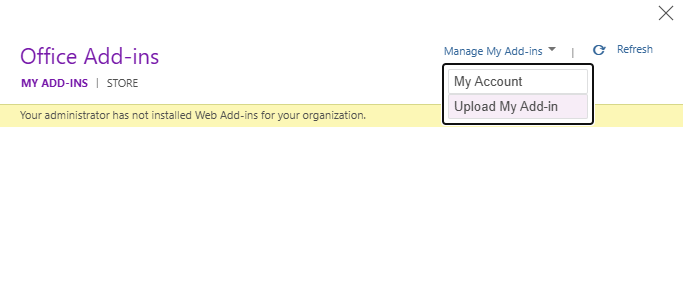

**Step 4.** Choose the `manifest.xml` you downloaded and click **Open**/**Upload**.

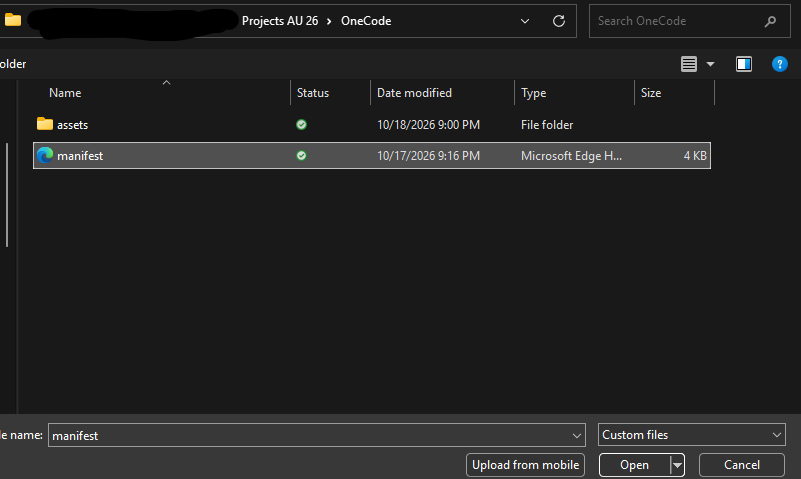

**Step 5.** Open the add-in from the ribbon (**OneCode Editor**).

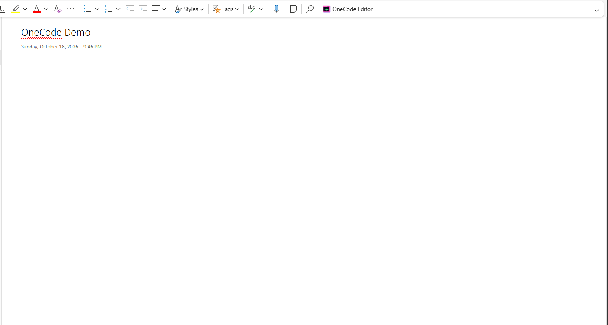

 

## Screenshots

**Light, Dark and Retro themes** (pick one from dropdown)

| Light | Dark |
| --- | --- |
| 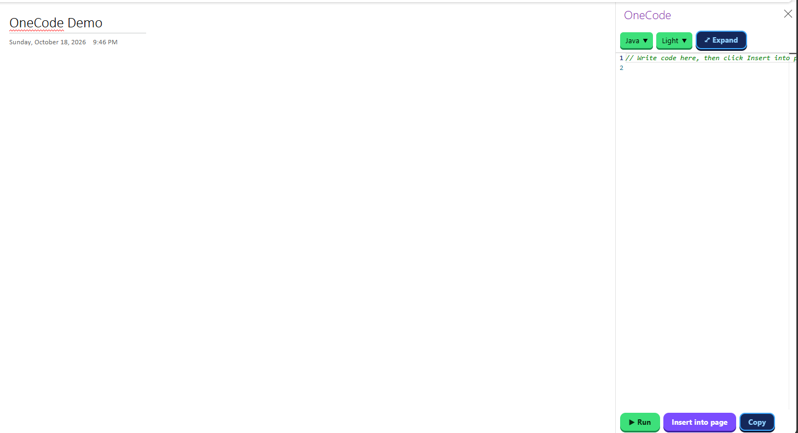 | 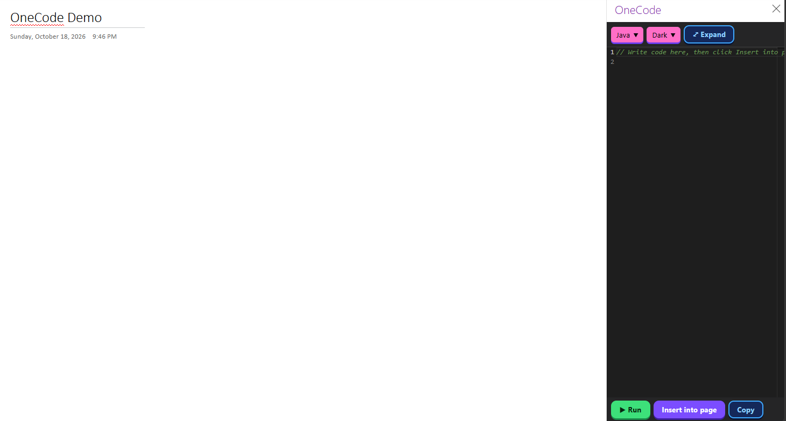 |

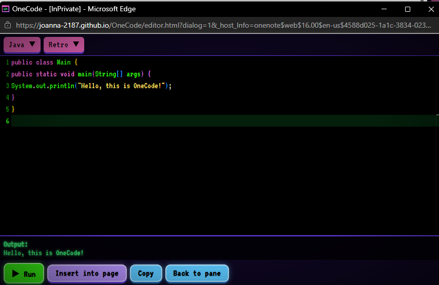

**Expand** opens a larger editor window, and **Run** shows the output below the code.

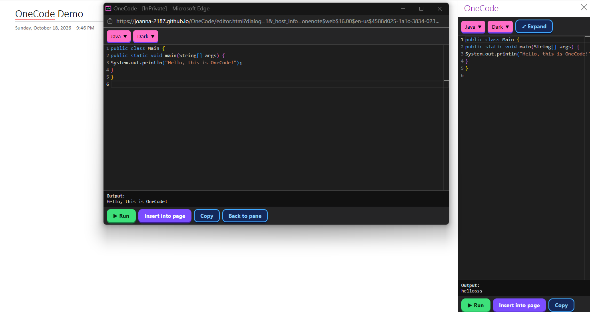

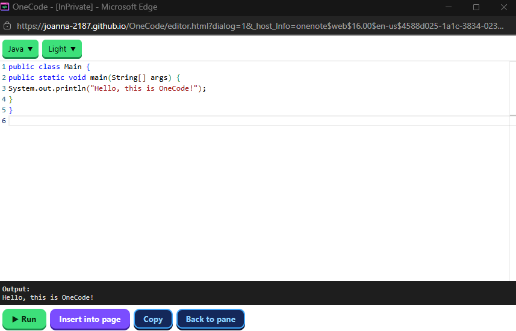

**Language dropdown**

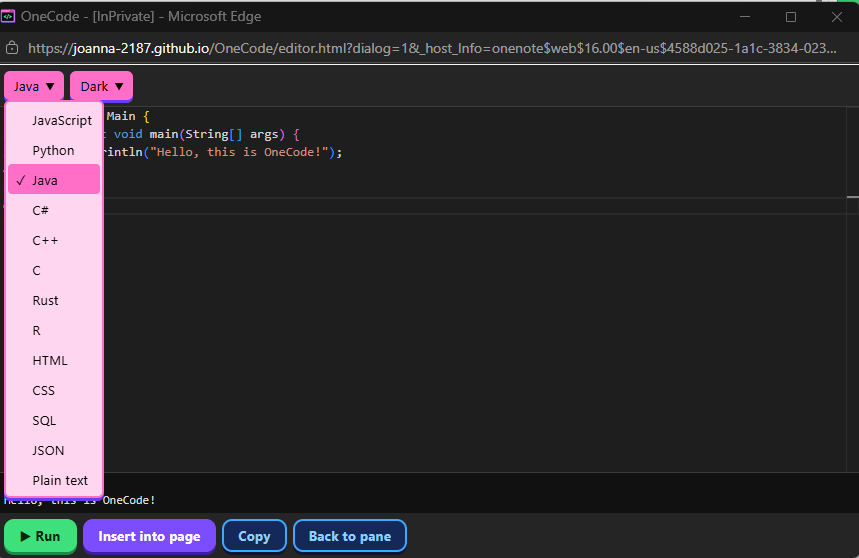

**Insert into page** puts the highlighted code and its output on the OneNote page.

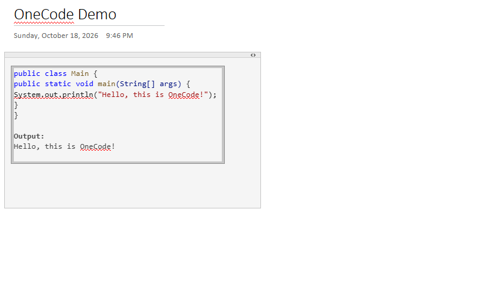

